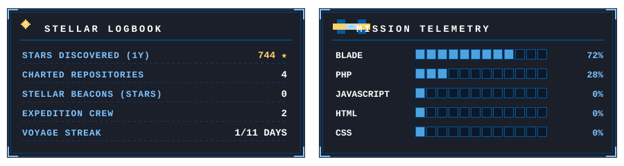

<!-- ═══════════ HERO BANNER (Stellar Explorer) ═══════════ -->

  

  

<!-- ═══════════ SOCIAL CHANNELS & COMMS ═══════════ -->

  
  
  
  

 

<!-- ═══════════ ASTRONAUT PROFILE ═══════════ -->
<h2 align="center">🧑‍🚀 Astronaut Profile</h2>

| | |
|:---|:---|
| 🔭 **Current Mission** | Simerah Koja |
| 🌱 **Learning Orbit** | Laravel &amp; Modern Web Architecture |
| 💼 **LinkedIn** | [Andika Dwi Putra](https://www.linkedin.com/in/andika-dwi-putra-79a502154/) |
| 📡 **Comms / Email** | dwiputdika@gmail.com |
| ⚡ **Fun Fact** | I enjoy playing *Wuthering Waves*, and my all-time favorite Pokémon is **Zorua** 🦊 |

 

<!-- ═══════════ EQUIPMENT & TECH STACK ═══════════ -->
<h2 align="center">🚀 Equipment &amp; Tech Stack</h2>

  
  
  
  
   
  
  
  
  

 

<!-- ═══════════ MISSION CONTROL STATS ═══════════ -->
<h2 align="center">📊 Mission Control Stats</h2>

  

 

<!-- ═══════════ CELESTIAL CARTOGRAPHY (DISCOVERED STARS) ═══════════ -->
<h2 align="center">🌌 Celestial Cartography (Discovered Stars)</h2>

  

<!-- ═══════════ FOOTER ═══════════ -->

  

